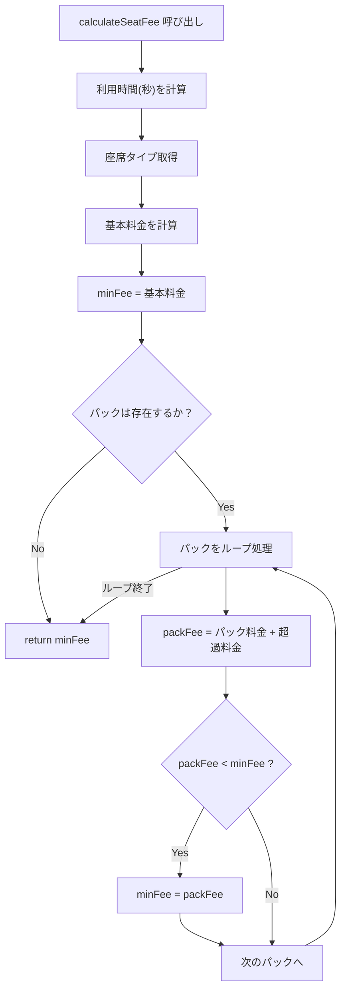
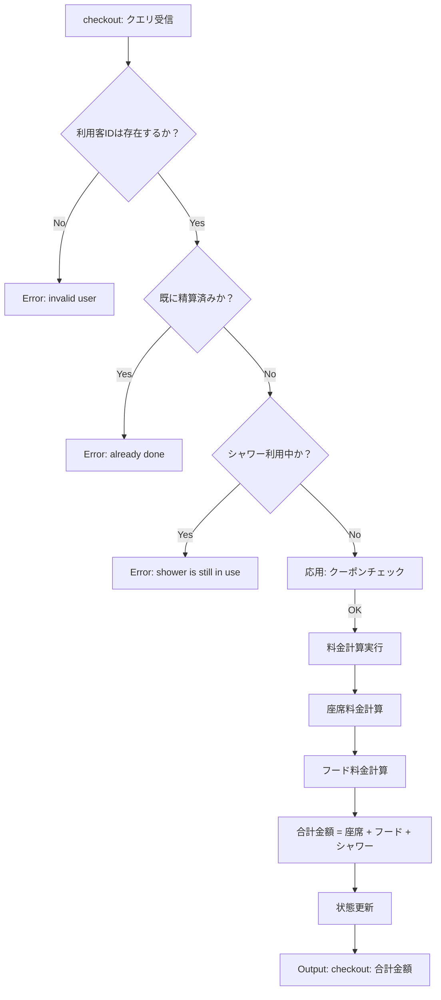
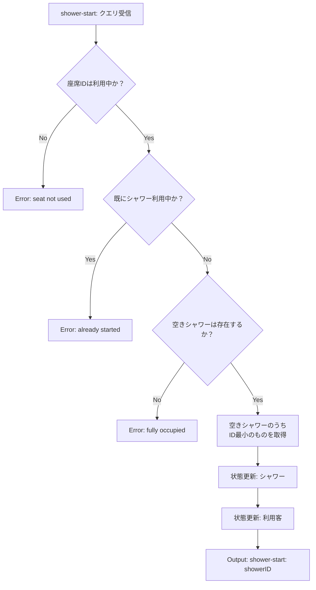
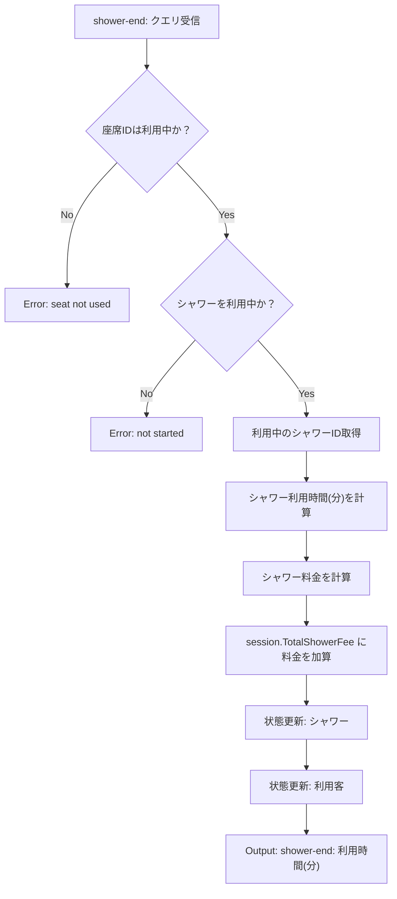

# Code Explanation

## `main.go`

このファイルは、プログラムのエントリーポイント（`main`関数）であり、シミュレーション全体の状態を管理するグローバル変数、入力の解析、クエリの振り分けという中核的な役割を担う

### `var (...)` (グローバル変数)

プログラム全体で共有される状態を保持する

- `lines`: `getStdin` によって読み込まれた標準入力の全行を保持するスライスである
- `currentLineIndex`: `lines` スライスのうち、次に読み込むべき行のインデックスである
- `seats`: 全座席の状態（ID, タイプ, ステータスなど）を保持するスライスであるインデックス`1`から`n`までを使用する（1-indexed）
- `seatTypes`: 座席タイプごとの料金情報（基本料金、パック一覧）を保持するマップであるキーは座席タイプID
- `foodPrices`: フードごとの価格を保持するマップであるキーはフードID
- `coupons`: クーポンごとの情報（対象フードID、割引額）を保持するマップであるキーはクーポンID
- `showers`: 全シャワールームの状態を保持するスライスである（1-indexed）
- `showerCharge`, `cleaningDurationSeat`, `cleaningDurationShower`: システム全体の設定値（シャワー料金、清掃時間）である
- `users`: 現在利用中または精算済みの全利用客セッションを保持するマップであるキーは利用客ID
- `nextUserID`: 次に発行する利用客ID`1`から始まり、`checkin` のたびにインクリメントされる

### `parseTime`

- **I/O:**

|  | arguments |
|-------|--------|
| Input | `timeStr string` - `YYYY/MM/DD-hh:mm:ss` 形式の時刻文字列 |
| Output | `time.Time` - パースされた時刻オブジェクト |

- **ロジック:**
  1. `time.Parse` を使用し、`const timeLayout` で定義されたフォーマットに基づいて文字列を `time.Time` 型に変換する

### `nextLine` / `nextInt` / `nextInts`

- **I/O:**

|  | arguments |
|-------|--------|
| Input | なし（`lines` グローバル変数から読み込み） |
| Output | `nextLine`: `string` - 次の行 / `nextInt`: `int` - 次の行を整数に変換 / `nextInts`: `[]int` - 次の行をスペース区切りで整数スライスに変換 |

- **ロジック:**
  1. `nextLine`: `currentLineIndex` が指す行を `lines` から取り出し、インデックスを1つ進める
  2. `nextInt`: `nextLine` で取得した文字列を `strconv.Atoi` で整数に変換する
  3. `nextInts`: `nextLine` で取得した文字列を `strings.Split` でスペース区切りに分割し、各要素を整数に変換したスライスを返す

### `parseInitialInput`

- **I/O:**

|  | arguments |
|-------|--------|
| Input | なし（`nextLine` 系関数を通じて標準入力から初期設定値を読み込む） |

- **ロジック:**
  1. 読み込んだ設定値に基づき、グローバル変数の `seats`, `seatTypes`, `foodPrices`, `coupons`, `showers` スライスおよびマップを初期化する
  2. 座席とシャワーは `StatusAvailable` で初期化される

### `updateAllStates`

- **I/O:**

|  | arguments |
|-------|--------|
| Input | `currentTime time.Time` - 現在のクエリ時刻 |

- **ロジック:**
  1. これは[応用実装]の清掃機能のための重要な関数である
  2. 全座席と全シャワーをスキャンする
  3. ステータスが `SeatCleaning` または `ShowerCleaning` のリソースを見つけた場合、そのリソースの `AvailableAt`（利用可能になる時刻）と `currentTime` を比較する
  4. `currentTime` が `AvailableAt` を過ぎている（`!currentTime.Before(AvailableAt)`）場合、そのリソースのステータスを `SeatAvailable` または `ShowerAvailable` に更新する
  5. この関数は、`main` ループですべてのクエリが処理される直前に必ず呼び出される

### `findSessionBySeatID`

- **I/O:**

|  | arguments |
|-------|--------|
| Input | `seatID int` - 座席ID |
| Output | `userID int` - 利用客ID / `*UserSession` - 利用客セッションへのポインタ（見つからない場合は `0, nil`） |

- **ロジック:**
  1. `get-duration` や `order-food` など、多くのハンドラで共通して使用されるヘルパー関数である
  2. `seats` スライスから指定された `seatID` の座席情報を取得する
  3. 座席が `SeatOccupied`（利用中）でない場合、`nil` を返す
  4. 座席が利用中の場合、`seat.UserID` を使って `users` マップから該当する `UserSession` を検索し、返す

### `calculateFee`

- **I/O:**

|  | arguments | | |
|-------|--------|--------|--------|
| Input | `durationSec float64` - 利用秒数 | `rate int` - 1回あたりの料金 | `intervalSec int` - 加算間隔（秒） |
| Output | `int` - 計算された合計料金 | | |

- **ロジック:**
  1. 座席の基本料金とシャワー料金の計算ロジックを共通化した関数である
  2. 利用時間が1秒未満の場合、料金は `0` である
  3. 利用時間が1秒以上の場合、まず `count = 1` として初回加算分を計上する
  4. `intervalSec` が `0` より大きい場合、初回加算（1秒）を除いた残りの時間（`overSec`）を `intervalSec` で割り、追加の加算回数を計算する（小数点以下は切り捨て）
  5. `totalCount - rate` を合計料金として返す

### `main` (メイン関数)

- **ロジック:**
  1. プログラムのエントリーポイントである
  2. `getStdin()` を呼び出し、標準入力のすべてを `lines` グローバル変数に一括で読み込む
  3. `users` マップを初期化する
  4. `parseInitialInput()` を呼び出し、システムの状態を初期化する
  5. `q`（クエリ数）を読み込み、`for` ループを開始する
  6. ループ内でクエリを1行ずつ `nextLine()` で読み込む
  7. クエリの時刻を取得し、`updateAllStates(currentTime)` を呼び出して、清掃が完了したリソースの状態を更新する
  8. `switch` 文を使い、クエリのコマンド（`checkin:` など）に応じて、`handleCheckIn` などの各クエリハンドラ関数に処理を振り分ける

### `getStdin`

- **I/O:**

|  | arguments |
|-------|--------|
| Input | なし（標準入力 `os.Stdin` から読み込み） |
| Output | `[]string` - 各行を要素とする文字列スライス |

- **ロジック:**
  1. `ioutil.ReadAll` を使用して、標準入力の終端までを一度にバイト列として読み込む
  2. 読み込んだバイト列を `string` に変換し、`strings.TrimRight` で末尾の改行を削除した後、`strings.Split` で改行文字（`\n`）を区切り文字として各行のスライスに変換する

## `typeCheckIn.go`

承知いたしました
`main.go` の解説のフォーマット（I/Oテーブルの追加）を反映し、`typeCheckIn.go` 以降の解説を作成します

---

## `typeCheckIn.go`

このファイルは、利用客の状態とセッション情報を管理するための型を定義する

### `UserStatus`

利用客の現在の状態を示す `int` 型のエイリアスである

- **ロジック:**
  1. `const` (定数) ブロックと `iota` を使用して、列挙型（enum）として定義される
  2. `UserInUse`: 利用客が座席を利用中（チェックイン済み）の状態を示す
  3. `UserCheckedOut`: 利用客が精算を完了した状態を示す

### `UserSession`

- **I/O:** なし（構造体定義）
- **ロジック:**
  1. 一人の利用客による一回の来店（チェックインからチェックアウトまで）に関する全ての情報を保持する構造体である
  2. この構造体のインスタンスは、`handleCheckIn` 時に作成され、`users` グローバルマップに `UserID` をキーとして保存される
  3. `ID`: 利用客ID (`1`, `2`, `3`...)
  4. `SeatID`: 割り当てられた座席のID
  5. `SeatTypeID`: （`checkoutHandlers.go` での修正により追加）割り当てられた座席のタイプID料金計算時に `seatTypes` マップを引くために使用される
  6. `CheckInTime`: チェックインした時刻 (`time.Time`)
  7. `Status`: `UserStatus` 型（`UserInUse` または `UserCheckedOut`）
  8. `FoodOrders`: 注文したフードを管理するマップキーは `フードID`、値は `注文回数`
  9. `TotalShowerFee`: このセッションで発生したシャワー料金の累計`handleShowerEnd` 時に加算される
  10. `CurrentShowerID`: 利用客が現在使用しているシャワーのID使用していない場合は `0`
  11. `ShowerStartTime`: `handleShowerStart` 時に記録される、現在のシャワー利用開始時刻`handleShowerEnd` 時に利用時間と料金の計算に使用される

## `typeFees.go`

このファイルは、座席料金体系とクーポンに関する型を定義する

### `Pack`

- **I/O:** なし（構造体定義）
- **ロジック:**
  1. 座席タイプごとに設定される定額パックの情報を保持する構造体である
  2. `TimeMinutes`: パックの適用時間（分単位）
  3. `Price`: パック料金

### `SeatType`

- **I/O:** なし（構造体定義）
- **ロジック:**
  1. 座席タイプの料金情報を保持する構造体である
  2. `ID`: 座席タイプのID
  3. `BasicRate`: 基本料金（10分ごとに加算される料金）
  4. `Packs`: この座席タイプで利用可能な定額パックのスライス
  5. システム全体で `map[int]SeatType` としてグローバル変数 `seatTypes` に保持される（キーは座席タイプID）

### `Coupon`

- **I/O:** なし（構造体定義）
- **ロジック:**
  1. フード注文時に適用可能なクーポンの情報を保持する構造体である
  2. `ID`: クーポンのID
  3. `TargetFoodID`: クーポンが対象とするフードのID
  4. `Discount`: クーポンの割引額
  5. システム全体で `map[int]Coupon` としてグローバル変数 `coupons` に保持される（キーはクーポンID）

## `typeSeats.go`

このファイルは、座席の状態管理に関する型を定義する

### `SeatStatus`

座席の現在の状態を示す `int` 型のエイリアスである

- **ロジック:**
  1. `const` (定数) ブロックと `iota` を使用して、列挙型（enum）として定義される
  2. `SeatAvailable`: 座席が利用可能な状態を示す
  3. `SeatOccupied`: 座席が利用中の状態を示す
  4. `SeatCleaning`: 座席が清掃中の状態を示す（応用実装）

### `Seat`

- **I/O:** なし（構造体定義）
- **ロジック:**
  1. 一つの座席の状態を保持する構造体である
  2. `ID`: 座席のID
  3. `TypeID`: この座席が属する座席タイプのID
  4. `Status`: 座席の現在の状態（`SeatStatus` 型）
  5. `UserID`: この座席を利用している利用客のID（空きの場合は `0`）
  6. `AvailableAt`: 清掃が完了し利用可能になる時刻（応用実装、`SeatCleaning` 状態の時に使用）
  7. システム全体で `[]Seat` としてグローバル変数 `seats` に保持される（サイズ `n+1`、インデックス `1` から `n` を使用）

## `typeShower.go`

このファイルは、シャワールームの状態管理に関する型を定義する

### `ShowerStatus`

シャワールームの現在の状態を示す `int` 型のエイリアスである

- **ロジック:**
  1. `const` (定数) ブロックと `iota` を使用して、列挙型（enum）として定義される
  2. `ShowerAvailable`: シャワールームが利用可能な状態を示す
  3. `ShowerOccupied`: シャワールームが利用中の状態を示す
  4. `ShowerCleaning`: シャワールームが清掃中の状態を示す（応用実装）

### `Shower`

- **I/O:** なし（構造体定義）
- **ロジック:**
  1. 一つのシャワールームの状態を保持する構造体である
  2. `ID`: シャワールームのID
  3. `Status`: シャワールームの現在の状態（`ShowerStatus` 型）
  4. `UserID`: このシャワールームを使用している利用客のID（空きの場合は `0`）
  5. `AvailableAt`: 清掃が完了し利用可能になる時刻（応用実装、`ShowerCleaning` 状態の時に使用）
  6. システム全体で `[]Shower` としてグローバル変数 `showers` に保持される（サイズ `s+1`、インデックス `1` から `s` を使用）
  7. シャワー料金（`showerCharge`）は、グローバル変数として別途保持される（15分ごとに加算される基本料金）

## `checkinHandlers.go`

このファイルは、`checkin` クエリの処理を担当する

### `handleCheckIn`

- **I/O:**

|  | arguments | |
|-------|--------|--------|
| Input | `fields []string` - クエリの文字列スライス | `currentTime time.Time` - 現在の時刻 |

- **ロジック:**
  1. `checkin:` クエリを処理する
  2. `fields[2]` から要求された座席タイプID（`seatTypeID`）を取得する
  3. `seats` スライスを `i = 1` からループし、`seatTypeID` が一致し、かつ `Status == SeatAvailable` である最初の座席（座席IDが最小）を探す
  4. 空席が見つからない場合、`checkin: fully occupied`を出力して処理を終了する
  5. 空席が見つかった場合（`foundSeatID`）、以下を実行する：
     1. `nextUserID` を使って新しい利用客ID（`userID`）を発行し、`nextUserID` をインクリメントする
     2. 新しい `UserSession` を作成し、`ID`、`SeatID`、`CheckInTime`（現在時刻）、`Status`（`UserInUse`）、空の `FoodOrders` マップなどを設定する
     3. `users` マップに新しいセッションを追加する（キーは `userID`）
     4. `seats[foundSeatID]` のステータスを `SeatOccupied` に更新し、`UserID` を設定する
     5.  `checkin: userid = {userID}, seatid = {foundSeatID}`を出力する

## `checkoutHandlers.go`

このファイルは、`checkout` クエリの処理と座席・フード料金の計算を担当する

### `calculateSeatFee`

- **I/O:**

|  | arguments | |
|-------|--------|--------|
| Input | `session *UserSession` - 利用客セッション | `currentTime time.Time` - 精算時刻 |
| Output | `int` - 計算された座席料金 | |

- **ロジック:**
  1. 座席利用料金を計算する関数である（最小料金制を実装）
  2. `currentTime.Sub(session.CheckInTime).Seconds()` で利用時間（秒）を計算する
  3. 利用時間を分単位に切り上げ（`math.Ceil`）して `totalMinutes` を求める
  4. `seats[session.SeatID].TypeID` から座席タイプIDを取得し、`seatTypes` マップから座席タイプ情報を取得する
  5. 基本料金を計算する：`calculateFee(durationSec, seatType.BasicRate, 600)` を呼び出し、パックなしの料金を求める（1秒後に初回加算、以降10分（600秒）ごと）
  6. 最小料金の初期値を基本料金に設定する
  7. 座席タイプに定義された各パック（`seatType.Packs`）について、以下を繰り返す：
     1. 利用時間がパック時間内に収まる場合、パック料金のみを `packFee` とする
     2. パック時間を超過している場合、超過分の時間（分）を計算し、その超過分を基本料金で計算して、パック料金に加算する
     3. `packFee` が現在の `minFee` より小さければ、`minFee` を更新する
  8. 全てのパックを検証した後、最小料金（`minFee`）を返す

### `calculateFoodFee`

- **I/O:**

|  | arguments | |
|-------|--------|--------|
| Input | `session *UserSession` - 利用客セッション | `couponIDs []int` - 使用するクーポンIDのスライス |
| Output | `int` - 計算されたフード料金 | |

- **ロジック:**
  1. フード料金を計算する関数である（応用実装：クーポン適用を含む）
  2. クーポン適用のルール3に従い、同じフードを対象とするクーポンが複数ある場合、割引額が最大のクーポン1つだけを適用する
  3. `maxDiscountPerFood` マップを作成し、各フードIDに対する最大割引額を記録する
  4. `couponIDs` をループし、各クーポンの対象フードIDと割引額を取得する
  5. 対象フードIDに対して、現在の最大割引額よりも大きい割引額があれば更新する
  6. `session.FoodOrders` をループし、注文された各フードについて以下を実行する：
     1. `foodPrices` から単価を取得する
     2. `maxDiscountPerFood` からこのフードIDに対する最大割引額を取得する（クーポンがなければ `0`）
     3. 割引適用後の単価を計算する（`price - discount`）
     4. 注文回数（`count`）を掛けて、合計に加算する（ルール2：クーポンは注文回数分すべてに適用される）
  7. フード料金の合計を返す

### `handleCheckout`

- **I/O:**

|  | arguments | |
|-------|--------|--------|
| Input | `fields []string` - クエリの文字列スライス | `currentTime time.Time` - 現在の時刻 |

- **ロジック:**
  1. `checkout:` クエリを処理する
  2. `fields[2]` から利用客ID、`fields[3]` からクーポン数を取得する
  3. クーポンIDのスライス（`couponIDs`）を `fields[4]` 以降から読み込む
  4. **エラーチェック（2a）**: 利用客IDが `users` マップに存在しない場合、`checkout: invalid user`を出力して終了する
  5. **エラーチェック（2b）**: セッションのステータスが既に `UserCheckedOut` の場合、`checkout: already done`を出力して終了する
  6. **エラーチェック（2c）**: セッションの `CurrentShowerID` が `0` でない（シャワー利用中）場合、`checkout: shower is still in use`を出力して終了する
  7. **エラーチェック（2d、応用実装）**: 各クーポンについて、対象フードが注文されているか確認する注文されていないフードのクーポンが含まれている場合、`checkout: invalid coupon`を出力して終了する（ルール4）
  8. `calculateSeatFee(session, currentTime)` を呼び出して座席料金を計算する
  9. `calculateFoodFee(session, couponIDs)` を呼び出してフード料金を計算する
  10. 合計料金を計算する：`totalFee = seatFee + foodFee + session.TotalShowerFee`
  11. `checkout: {totalFee}`を出力する
  12. セッションのステータスを `UserCheckedOut` に更新する
  13. 座席の状態を更新する：
      1. `seats[session.SeatID].UserID` を `0` にする
      2. 応用実装：`cleaningDurationSeat` が `0` より大きい場合、座席のステータスを `SeatCleaning` に設定し、`AvailableAt` を `currentTime + cleaningDurationSeat` に設定する
      3. 基本実装：`cleaningDurationSeat` が `0` の場合、座席のステータスを `SeatAvailable` に設定する

## `getDurationHandler.go`

このファイルは、`get-duration` クエリの処理を担当する

### `handleGetDuration`

- **I/O:**

|  | arguments | |
|-------|--------|--------|
| Input | `fields []string` - クエリの文字列スライス | `currentTime time.Time` - 現在の時刻 |

- **ロジック:**
  1. `get-duration:` クエリを処理する
  2. `fields[2]` から座席ID（`seatID`）を取得する
  3. `findSessionBySeatID(seatID)` を呼び出して、該当する利用客セッションを取得する
  4. セッションが `nil` の場合（座席が利用中でない場合）、`get-duration: seat not used`を出力して終了する
  5. セッションが存在する場合、`currentTime.Sub(session.CheckInTime)` で利用時間（`duration`）を計算する
  6. 利用時間を秒から分に変換し、切り上げ（`math.Ceil`）して整数の分数（`minutes`）を求める
  7. `get-duration: {minutes}`を出力する

## `getVacantSeats.go`

このファイルは、`get-vacant-seats` クエリの処理を担当する

### `handleGetVacantSeats`

- **I/O:**

|  | arguments | |
|-------|--------|--------|
| Input | `fields []string` - クエリの文字列スライス | `currentTime time.Time` - 現在の時刻 |

- **ロジック:**
  1. `get-vacant-seats:` クエリを処理する
  2. 座席タイプごとに空席をカウントするマップ（`vacanciesPerType`）を作成する（キー：座席タイプID、値：空席数）
  3. 全座席（`seats[1]` から `seats[n]`）をスキャンする
  4. 各座席について、以下の条件で空席と判定する：
     1. 座席のステータスが `SeatAvailable` の場合
     2. 応用実装：座席のステータスが `SeatCleaning` で、かつ現在時刻（`currentTime`）が `seat.AvailableAt` 以上の場合（清掃完了済み）
  5. 空席と判定された座席について、`vacanciesPerType[seat.TypeID]` をインクリメントする
  6. 座席タイプID `1` から `m`（`len(seatTypes)`）まで昇順にループする
  7. 各座席タイプについて、`vacanciesPerType` から空席数を取得する（存在しない場合は `0`）
  8. 空席数が `0` より大きい座席タイプのみ、`{座席タイプID} {空席数}`の形式で出力行（`outputLines`）に追加する
  9. 空席が存在する座席タイプの種類数（`v`）をカウントする
  10. `get-vacant-seats: {v}`を出力する
  11. `v` が `0` より大きい場合、`outputLines` を改行で結合して出力する

## `orderFoodHandler.go`

このファイルは、`order-food` クエリの処理を担当する

### `handleOrderFood`

- **I/O:**

|  | arguments | |
|-------|--------|--------|
| Input | `fields []string` - クエリの文字列スライス | `currentTime time.Time` - 現在の時刻 |

- **ロジック:**
  1. `order-food:` クエリを処理する
  2. `fields[2]` から座席ID（`seatID`）、`fields[3]` からフードID（`foodID`）を取得する
  3. `findSessionBySeatID(seatID)` を呼び出して、該当する利用客セッションを取得する
  4. セッションが `nil` の場合（座席が利用中でない場合）、`order-food: seat not used`を出力して終了する
  5. セッションが存在する場合、`session.FoodOrders[foodID]` をインクリメントして注文回数を記録する
  6. `order-food: ok`を出力する

## `showerHandlers.go`

このファイルは、`shower-start` と `shower-end` クエリの処理を担当する

### `handleShowerStart`

- **I/O:**

|  | arguments | |
|-------|--------|--------|
| Input | `fields []string` - クエリの文字列スライス | `currentTime time.Time` - 現在の時刻 |

- **ロジック:**
  1. `shower-start:` クエリを処理する
  2. `fields[2]` から座席ID（`seatID`）を取得する
  3. **エラーチェック（1）**: `findSessionBySeatID(seatID)` を呼び出してセッションを取得し、`nil` の場合（座席が利用中でない場合）、`shower-start: seat not used`を出力して終了する
  4. **エラーチェック（2）**: セッションの `CurrentShowerID` が `0` でない場合（既にシャワー利用中）、`shower-start: already started`を出力して終了する
  5. 空きシャワー（`ShowerAvailable`）を探す：`showers` スライスを `i = 1` からループし、最初に見つかったシャワー（ID最小）を取得する
  6. **エラーチェック（3）**: 空きシャワーが見つからない場合、`shower-start: fully occupied`を出力して終了する
  7. 空きシャワーが見つかった場合、以下の状態更新を実行する：
     1. `showers[foundShowerID].Status` を `ShowerOccupied` に設定する
     2. `showers[foundShowerID].UserID` をセッションの利用客IDに設定する
     3. `session.CurrentShowerID` を `foundShowerID` に設定する
     4. `session.ShowerStartTime` を現在時刻（`currentTime`）に設定する
  8. `shower-start: {foundShowerID}`を出力する

### `handleShowerEnd`

- **I/O:**

|  | arguments | |
|-------|--------|--------|
| Input | `fields []string` - クエリの文字列スライス | `currentTime time.Time` - 現在の時刻 |

- **ロジック:**
  1. `shower-end:` クエリを処理する
  2. `fields[2]` から座席ID（`seatID`）を取得する
  3. **エラーチェック（1）**: `findSessionBySeatID(seatID)` を呼び出してセッションを取得し、`nil` の場合（座席が利用中でない場合）、`shower-end: seat not used`を出力して終了する
  4. **エラーチェック（2）**: セッションの `CurrentShowerID` が `0` の場合（シャワーを利用していない場合）、`shower-end: not started`を出力して終了する
  5. セッションからシャワーID（`showerID = session.CurrentShowerID`）を取得する
  6. シャワー利用時間を計算する：`currentTime.Sub(session.ShowerStartTime)` で `duration` を求め、秒数（`durationSec`）に変換する
  7. シャワー料金を計算する：`calculateFee(durationSec, showerCharge, 900)` を呼び出す（1秒後に初回加算、以降15分（900秒）ごと）
  8. 計算した料金を `session.TotalShowerFee` に加算する
  9. 利用時間を分単位に切り上げ（`math.Ceil`）して整数の分数（`minutes`）を求める
  10. 以下の状態更新を実行する：
      1. `session.CurrentShowerID` を `0` に設定する
      2. 基本実装：`showers[showerID].Status` を `ShowerAvailable` に設定する
      3. 応用実装：清掃時間が設定されている場合は `ShowerCleaning` に設定し、`AvailableAt` を設定する（コメントで言及）
      4. `showers[showerID].UserID` を `0` に設定する
  11. `shower-end: {minutes}`を出力する

