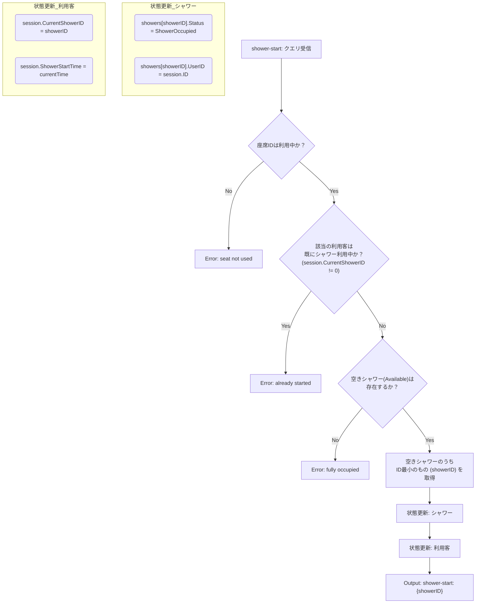
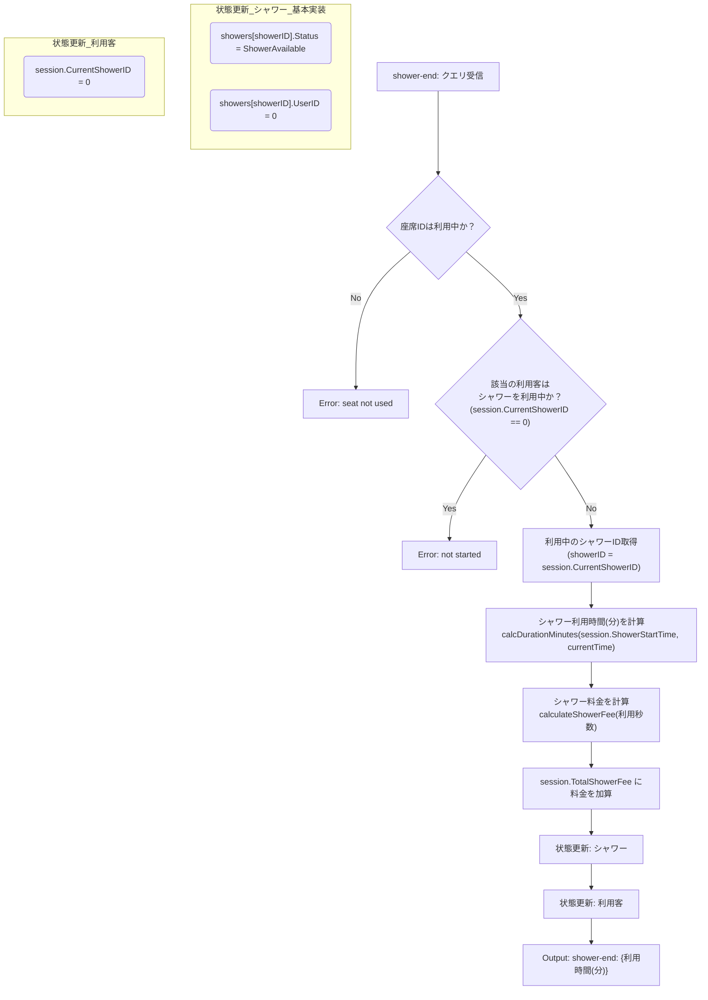
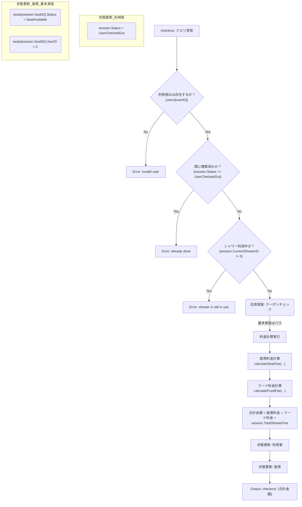
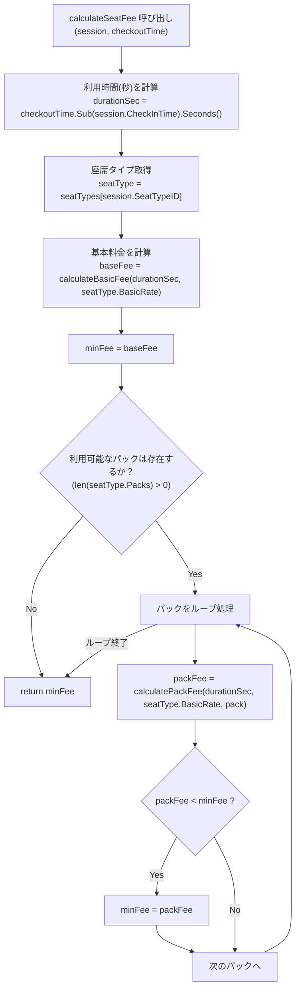
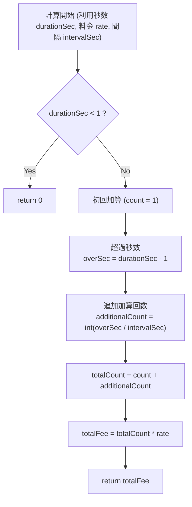

# クエリロジック設計図

1. シャワー利用のロジック (shower-start / shower-end)

シャワー利用は、利用客 (UserSession) と シャワーリソース (Shower) の2つの状態が連動して変化します。

handleShowerStart (シャワー使用開始)

利用客（座席IDで指定）がシャワーを使おうとする時の処理です。

handleShowerEnd (シャワー使用終了)

利用客がシャワー利用を終える時の処理です。シャワー料金の計算がここで行われます。

2. 精算処理のロジック (checkout)

最も複雑なクエリです。まず「エラーチェック」と「正常系の状態遷移」を整理し、次に「料金計算」を詳細化します。

handleCheckout (エラーチェックと状態遷移)

calculateSeatFee (座席料金計算：最小料金制)

handleCheckout の中核となるロジックです。

calculateBasicFee / calculateShowerFee (基本料金/シャワー料金の計算)

この2つのロジックは非常に似ていますが、加算タイミングと加算間隔が異なります。

座席基本料金: 1秒後に初回加算、以降**10分(600秒)**ごと

シャワー料金: 1秒後に初回加算、以降**15分(900秒)**ごと

- calculateBasicFee 実行時: intervalSec = 600
- calculateShowerFee 実行時: intervalSec = 900
